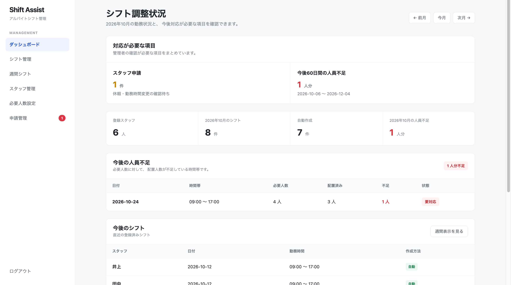
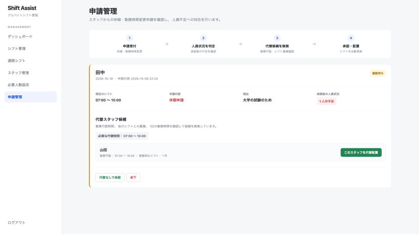
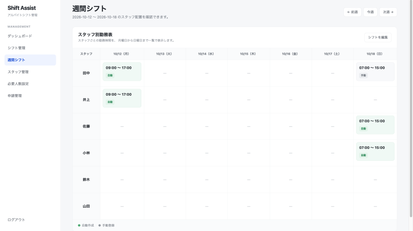
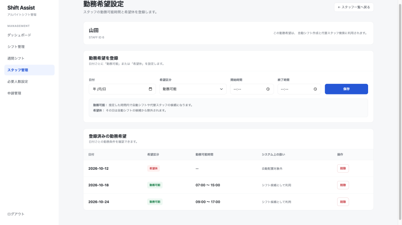
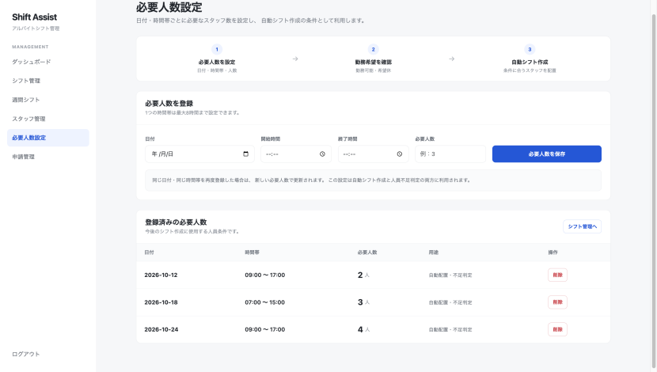
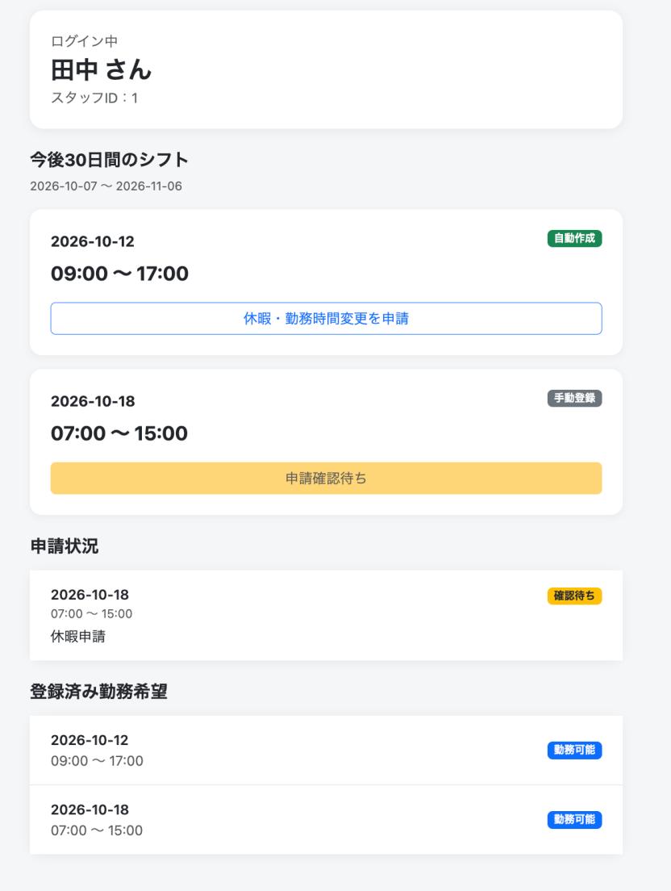

# Shift Assist

アルバイトスタッフ向けのシフト管理Webシステムです。

ホテルでのアルバイト経験から感じた「シフト調整の負担」をきっかけに、勤務希望・必要人数をもとにした自動シフト作成、人員不足の検出、休暇申請、代替スタッフ候補の検索までを一つのシステムとして実装しました。

> 現在の自動シフト作成はAI・機械学習ではなく、勤務条件を用いたルールベースの処理です。

---

## 1. 開発背景

ホテルでアルバイトをしていた際、スタッフの休みや勤務時間の変更が発生するたびに、管理者が一人ずつ連絡してシフトを調整している場面を見ました。

特に人員が不足した場合には、管理者自身が現場に入ることもありました。

そこで、

- スタッフの勤務可能時間をまとめて管理する
- 必要人数をもとにシフトを自動作成する
- 人員不足を早めに確認する
- 急な休みが発生した場合に代替スタッフを探す

といった作業をシステム化することで、管理者の負担を減らせないかと考え、本システムを開発しました。

---

## 2. 主な機能

### 管理者側

- スタッフ登録・削除
- 勤務可能時間の登録
- 希望休の登録
- 日付・時間帯ごとの必要人数設定
- 条件に基づく自動シフト作成
- 手動シフト追加・編集
- シフト重複チェック
- 週間シフト表示
- 人員不足の検出
- 今後60日間の人員不足アラート
- 休暇・勤務時間変更申請の確認
- 承認後の人員不足判定
- 代替スタッフ候補の自動検索
- 代替スタッフの配置

### スタッフ側

- スタッフID・PINによるログイン
- 自分のシフト確認
- 自分の勤務希望確認
- 休暇申請
- 勤務時間変更申請
- 申請状況の確認

---

## 3. システムの流れ

```text
勤務可能時間・希望休
          +
      必要人数設定
          ↓
    自動シフト作成
          ↓
     週間シフト確認
          ↓
スタッフから休暇・勤務時間変更申請
          ↓
   承認後の人員状況を判定
          ↓
      人員不足が発生
          ↓
    代替スタッフを検索
          ↓
      管理者が承認
          ↓
       シフト更新
```

---

## 4. Screenshots

### Dashboard

スタッフからの申請、人員不足、登録済みシフトなど、管理者が対応すべき情報をまとめて確認できます。



---

### 休暇申請・代替スタッフ推薦

スタッフから休暇申請があった場合、承認後に人員不足が発生するかを判定します。

不足が発生する場合は、勤務可能時間、他のシフトとの重複、1日の勤務時間などを確認し、条件に合う代替スタッフ候補を表示します。



---

### 週間シフト

スタッフごとの勤務状況を週間単位で確認できます。

自動作成されたシフトと、管理者が手動登録したシフトを区別して表示しています。



---

### 勤務希望設定

スタッフごとに「勤務可能時間」と「希望休」を登録できます。

勤務可能時間は、自動シフト作成と代替スタッフ検索の条件として利用されます。



---

### 必要人数設定

日付・時間帯ごとに必要なスタッフ人数を登録できます。

この情報は、自動シフト作成と人員不足判定の両方に利用されます。



---

### スタッフ用画面

スタッフは自分のシフトを確認し、休暇・勤務時間変更を申請できます。

申請後は、現在の承認状況も確認できます。

<p align="center">
  
</p>

---

## 5. 使用技術

| 分類 | 技術 |
|---|---|
| Backend | Python |
| Web Framework | Flask |
| Database | SQLite |
| Frontend | HTML / CSS / Bootstrap |
| Template Engine | Jinja2 |
| Authentication | Flask Session |
| Password Hash | Werkzeug / PBKDF2-SHA256 |
| Version Control | Git / GitHub |

---

## 6. データベース構成

本システムでは、主に5つのテーブルを使用しています。

### `staff`

スタッフ情報を管理します。

主な項目：

- `id`
- `name`
- `password_hash`

### `shifts`

スタッフのシフトを管理します。

主な項目：

- `id`
- `employee_id`
- `shift_date`
- `start_time`
- `end_time`
- `source`

`source` により、自動作成されたシフトと手動登録されたシフトを区別しています。

### `availability`

スタッフの勤務希望を管理します。

主な項目：

- `employee_id`
- `work_date`
- `preference_type`
- `start_time`
- `end_time`

`preference_type` は以下の2種類です。

```text
available : 勤務可能
off       : 希望休
```

### `staffing_requirements`

日付・時間帯ごとの必要人数を管理します。

主な項目：

- `work_date`
- `start_time`
- `end_time`
- `required_staff`

### `shift_requests`

スタッフからの休暇・勤務時間変更申請を管理します。

主な項目：

- `employee_id`
- `shift_id`
- `request_type`
- `requested_start_time`
- `requested_end_time`
- `reason`
- `status`
- `created_at`

---

## 7. 自動シフト作成ロジック

現在の自動シフト作成は、機械学習ではなくルールベースです。

基本的な処理は以下の通りです。

### 1. 必要人数を確認

指定された日付・時間帯について、必要人数を取得します。

### 2. すでに配置されている人数を確認

対象時間帯を完全にカバーしているスタッフ数を確認します。

```text
不足人数 = 必要人数 - 配置済み人数
```

### 3. 勤務可能スタッフを検索

以下の条件を満たすスタッフを検索します。

- 対象日に「勤務可能」と登録されている
- 勤務可能時間が必要時間帯をカバーしている
- 希望休ではない
- 同日のシフト条件に問題がない

### 4. 候補者を選択

現在登録されているシフト数が少ないスタッフを優先し、勤務の偏りをできるだけ抑えるようにしています。

### 5. 人員不足を表示

必要人数を満たせない場合は無理に配置せず、「人員不足」としてDashboardに表示します。

---

## 8. 代替スタッフ検索ロジック

スタッフの休暇・勤務時間変更によって人員不足が発生する場合、代替候補を検索します。

候補者は、主に以下の条件で判定します。

- 申請したスタッフ本人ではない
- 対象日に勤務可能
- 必要な時間帯を勤務可能時間がカバーしている
- 他のシフトと時間が重複していない
- 追加後の1日の勤務時間が設定した上限を超えない

条件を満たしたスタッフがいる場合、管理者画面に代替候補として表示します。

管理者が候補者を選択すると、

```text
元スタッフのシフト変更・削除
            ↓
代替スタッフのシフト追加
            ↓
申請ステータスをapprovedへ変更
```

という処理を行います。

---

## 9. 開発中に改善した点

### JSONからSQLiteへの移行

開発初期はJSONファイルにデータを保存していました。

しかし、

- スタッフ
- シフト
- 勤務希望
- 必要人数

など、関連するデータが増えるにつれて管理が難しくなりました。

そこでSQLiteへ移行し、テーブルとIDを使ってデータを管理する構成に変更しました。

---

### IDを使ったデータ管理

SQLite移行後、画面上のリスト順とデータベースのIDを混同し、誤ったデータを削除する問題が発生しました。

そのため、各データをPRIMARY KEYで一意に識別し、編集・削除処理でもIDを使用するように修正しました。

この経験から、データベースにおけるID管理の重要性を学びました。

---

### 自動シフト条件の改善

初期の処理では、勤務可能なスタッフを単純に配置していました。

その後、

- 希望休
- 必要人数
- 勤務可能時間
- 他シフトとの重複
- 既存シフト数
- 人員不足

などの条件を追加し、実際のシフト業務に近い形へ改善しました。

---

### 作成後の変更にも対応

最初は「シフトを作成すること」を中心に開発していました。

しかし、実際のアルバイトでは作成後の急な休みや勤務時間変更への対応も大きな負担になります。

そこで、

```text
休暇申請
↓
人員不足判定
↓
代替スタッフ検索
↓
再配置
```

までを一つの流れとして追加しました。

---

## 10. テスト

現在はテストデータを使った手動テストを中心に行っています。

確認した主なケース：

- 希望休のスタッフが自動配置されない
- 勤務可能時間外のスタッフが配置されない
- 必要人数を満たせない場合に不足が表示される
- シフト時間が重複する場合に警告される
- 休暇申請後に人員不足が再計算される
- 条件に合う代替スタッフが表示される
- 代替スタッフ配置後にシフトが更新される
- 未ログイン状態で管理画面へアクセスできない

---

## 11. 現在の課題

本システムは学習・ポートフォリオを目的とした個人開発です。

実際のホテルや店舗への導入は行っていません。

現在の主な課題：

- 自動シフト作成は単純なルールベース
- スタッフのスキルを考慮していない
- 契約勤務時間を考慮していない
- 人件費最適化を行っていない
- 自動テストを導入していない
- SQLiteのため大規模同時利用には向いていない
- 本番環境を想定したセキュリティ対策は未実装

---

## 12. 今後の改善

今後は以下のような改善を考えています。

### シフト最適化

勤務回数だけではなく、

- 勤務時間
- 希望勤務回数
- スタッフのスキル
- 人件費
- 契約条件

などを考慮したシフト作成。

### 必要人数予測

ホテルのような業務の場合、

- 曜日
- 祝日
- 過去の来客数
- ホテル稼働率
- イベント

などのデータから必要人数を予測する機能を追加することも考えています。

この場合、必要人数の予測には機械学習、スタッフ配置には制約条件を考慮した最適化処理を組み合わせる方法が考えられます。

### 本番運用対応

- PostgreSQLなどへの移行
- 環境変数による秘密情報管理
- CSRF対策
- HTTPS
- 権限管理
- 自動テスト

などを追加する必要があります。

---

## 13. ローカル環境での実行方法

### 1. RepositoryをClone

```bash
git clone https://github.com/tdot3/shift-assist.git
```

```bash
cd shift-assist
```

### 2. Virtual Environmentを作成

macOS / Linux：

```bash
python3 -m venv venv
```

```bash
source venv/bin/activate
```

### 3. 必要パッケージをインストール

```bash
pip install -r requirements.txt
```

### 4. デモデータを作成

```bash
python seed_demo.py
```

### 5. Flaskを起動

```bash
python app.py
```

ブラウザから以下へアクセスします。

```text
http://127.0.0.1:5001
```

---

## 14. デモ用アカウント

### 管理者

```text
Username: admin
Password: 123456
```

### スタッフ

デモデータ作成後：

```text
STAFF ID: 1
PIN: 1234
```

※ 上記はローカルデモ用の初期認証情報です。実運用を想定した認証情報ではありません。

---

## 15. プロジェクトについて

本プロジェクトは、ホテルでのアルバイト経験から感じた課題をもとに作成した個人開発プロジェクトです。

開発を通して、単に画面やプログラムを作るだけではなく、

- 実際の業務上の問題を整理する
- 必要なデータを整理する
- 条件をプログラムで判断できる形にする
- テスト結果から問題を発見する
- 段階的に機能を改善する

という開発プロセスを経験しました。

今後も、実際の利用場面を意識しながら改善していきたいと考えています。